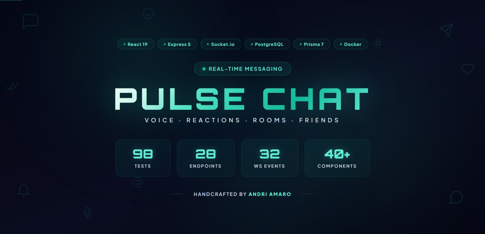
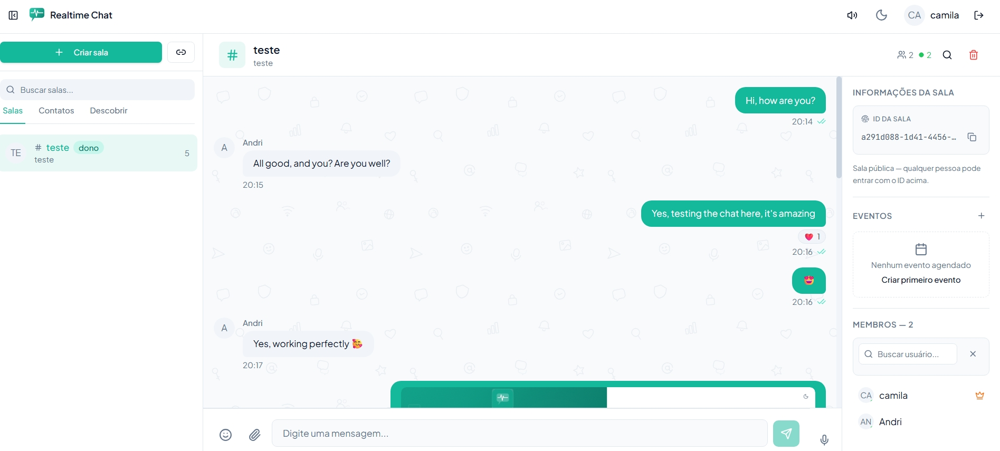
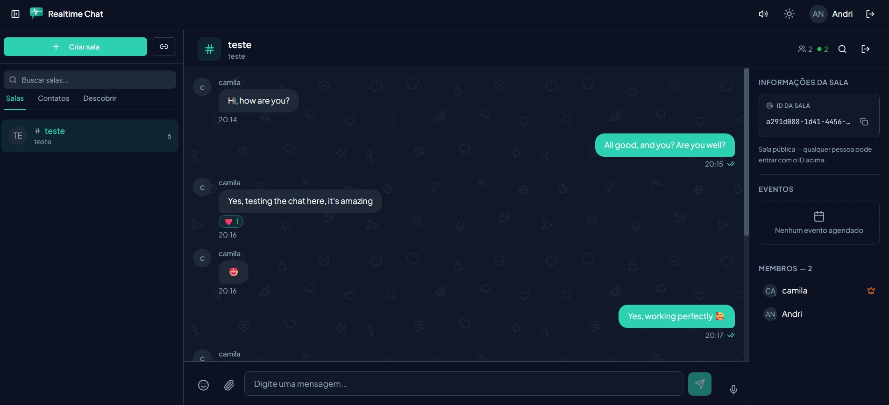
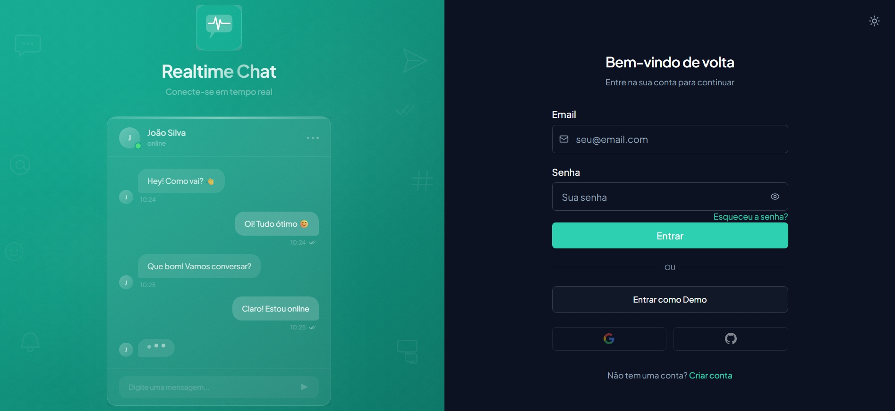
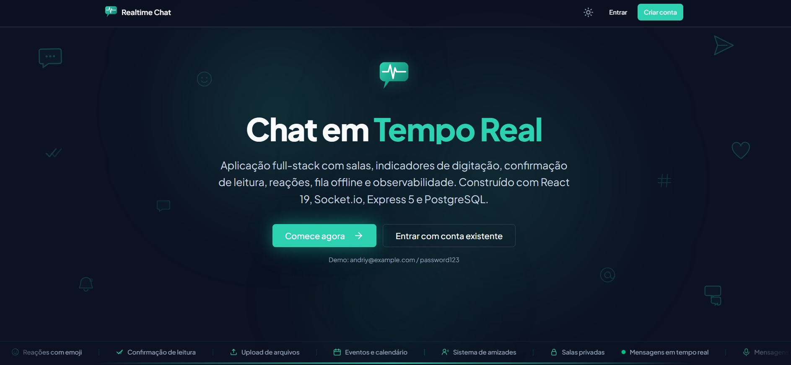
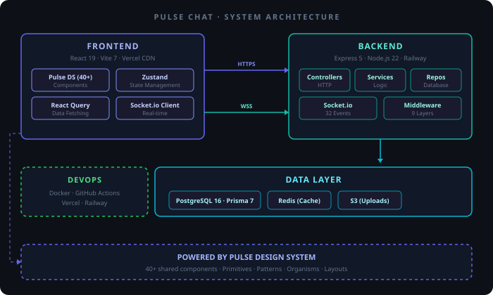

<!-- Hero Banner -->
<div align="center">
  
</div>

<div align="center">

# Pulse Chat

**Full-stack real-time messaging with voice, reactions, rooms & friends**

[](https://github.com/AndriyAmaro/realtime-chat/actions/workflows/ci.yml)


**[Live Demo](https://realtime-chat-eight-beryl.vercel.app)** · **[API Docs (Swagger)](https://server-production-f308.up.railway.app/api/docs)** · **[Architecture](/docs/architecture.md)**

> Demo credentials: `andriy@example.com` / `password123`

</div>

---

<div align="center">

> **Part of the [Pulse Ecosystem](https://github.com/AndriyAmaro/pulse-saas-theme)** · Built on 40+ shared design system components

</div>

---

## Screenshots

<div align="center">
  
  <br />
  <sub>Real-time chat · emoji reactions, read receipts, room info panel, events & member management</sub>
</div>

<br />

<div align="center">
  
  
  <br />
  <sub>Dark mode chat view &nbsp;·&nbsp; Login page with chat preview and social auth</sub>
</div>

<br />

<div align="center">
  
  <br />
  <sub>Landing page · feature marquee with dark/light theme toggle</sub>
</div>

---

## Features

### Core

- Real-time messaging via WebSocket (Socket.io)
- Public and private rooms with invite codes
- JWT authentication with auto-refresh tokens
- Full-text message search with keyword highlighting
- User profiles with avatar upload

### Voice & Media

- Voice messages with in-browser recording (MediaRecorder API, WebM/Opus)
- File and image sharing (5MB max, drag & drop)
- Inline audio player with duration display

### Real-Time

- Typing indicators with auto-timeout
- Online / Away / Offline status per room
- Read receipts (sent / read)
- Emoji reactions (toggle pattern, aggregated by emoji)
- Edit and delete messages (soft delete)
- Reply threads with quoted preview
- Pinned messages with collapsible banner (admin/owner)

### Social

- Friend system (send, accept, decline requests)
- Room events & calendar with RSVP (accept/decline invites)
- Member management with role-based permissions (owner, admin, member)

### Resilience

- Offline message queue with exponential backoff retry
- Reconnection sync · fills missed messages automatically
- Idempotency keys · deduplication within 5-minute window
- Socket-level rate limiting (per-event, per-user)
- Multi-device support (same user, multiple tabs)

### Infrastructure

- Structured JSON logging (Pino) with request ID correlation
- In-memory performance metrics (`/admin/metrics`)
- Error tracking with fingerprinting (`/admin/errors`)
- Graceful shutdown (Socket.io → HTTP → Prisma → metrics log)
- Health check with dependency status (`/api/v1/health`)
- Code splitting with 4 vendor chunks + lazy-loaded routes

---

## Tech Stack

| Layer | Technologies |
|-------|-------------|
| **Frontend** | React 19, Vite 7, TypeScript 5.9, Tailwind CSS 4, Radix UI, Zustand, React Query, Socket.io Client |
| **Backend** | Node.js 22, Express 5, TypeScript 5.9, Prisma 7, PostgreSQL 16, Socket.io, Pino, JWT, Zod |
| **DevOps** | Docker Compose, GitHub Actions (CI/CD), Vercel (frontend), Railway (backend + database) |
| **Design System** | 40+ reusable components from Pulse (primitives, organisms, patterns, layouts) |

---

## Architecture

<div align="center">
  
</div>

**Backend follows 3-layer architecture**: Middleware → Controller → Service → Repository. Each layer has a single responsibility · controllers handle HTTP, services hold business logic, repositories talk to the database.

> Deep dive: [Architecture](/docs/architecture.md) · [ADRs](/docs/decisions.md) · [Scaling Strategy](/docs/scaling.md)

---

## Key Metrics

| Metric | Value |
|--------|-------|
| Prisma Models | **10** |
| REST API Endpoints | **28** |
| Socket.io Events | **32** |
| Automated Tests | **98** |
| Custom React Hooks | **17** |
| Design System Components | **40+** |
| Middleware Stack | **9** |
| Docker Services | **5** |

---

## Quick Start

### Prerequisites

- [Docker](https://docs.docker.com/get-docker/) and Docker Compose
- [Node.js 22+](https://nodejs.org/) (for local development)

### With Docker (recommended)

```bash
git clone https://github.com/AndriyAmaro/realtime-chat.git
cd realtime-chat
cp .env.example .env
docker compose up -d
```

Access at **http://localhost** · PostgreSQL on port 5433, Redis on port 6380.

### Local Development

```bash
# Terminal 1: Start databases
docker compose up -d postgres redis

# Terminal 2: Backend
cd server
npm install
npx prisma migrate dev
npx prisma db seed
npx tsx watch src/app.ts

# Terminal 3: Frontend
cd client
npm install
npm run dev
```

Frontend at **http://localhost:3000**, backend at **http://localhost:4000**.

---

## Project Structure

```
realtime-chat/
├── client/                  # React 19 + Vite SPA
│   ├── src/
│   │   ├── core/            # Pulse Design System (40+ components)
│   │   ├── components/      # App-specific components
│   │   ├── pages/           # Route pages (auth, chat, landing)
│   │   ├── hooks/           # 17 custom hooks (useMessages, useVoiceRecorder, etc.)
│   │   ├── services/        # API clients + socket manager
│   │   └── store/           # Zustand stores (auth, notification)
│   └── index.html
├── server/                  # Express 5 + TypeScript
│   ├── src/
│   │   ├── config/          # Env, database, logger, socket setup
│   │   ├── controllers/     # HTTP request handlers
│   │   ├── services/        # Business logic
│   │   ├── repositories/    # Prisma database queries
│   │   ├── events/          # Socket.io event handlers (5 modules)
│   │   ├── middleware/       # 9 middleware (auth, validation, rate limiting, logging)
│   │   ├── routes/          # Express route definitions
│   │   └── errors/          # Domain error classes
│   └── prisma/              # Schema + migrations
├── docs/                    # Architecture documentation
│   ├── architecture.md      # System diagrams + data flow
│   ├── decisions.md         # 9 Architecture Decision Records
│   ├── scaling.md           # Scaling strategy (500 → 100K users)
│   └── why-i-built-this.md  # Project motivation + lessons learned
├── docker-compose.yml       # 5 orchestrated services
└── .github/workflows/       # CI/CD pipeline
```

---

## API Documentation

Interactive Swagger UI available at [`/api/docs`](https://server-production-f308.up.railway.app/api/docs).

- **28 REST endpoints** across 8 route groups (Auth, Rooms, Members, Messages, Events, Friendships, Uploads, Admin)
- **32 Socket.io events** (19 server→client + 13 client→server)

---

## Documentation

| Document | Description |
|----------|-------------|
| [Architecture](/docs/architecture.md) | System diagrams, data flow, auth flow, database schema |
| [Decisions](/docs/decisions.md) | 9 ADRs · why Vite over Next.js, Express over Fastify, Prisma adapter pattern, etc. |
| [Scaling](/docs/scaling.md) | 3-tier strategy from 500 to 100K+ users with cost estimates |
| [Why I Built This](/docs/why-i-built-this.md) | Project motivation, trade-offs, and lessons learned |

---

## What Powers the Ecosystem

Pulse Chat is part of the **Pulse Ecosystem** · multiple SaaS apps sharing one design system:

| App | Stack | Status |
|-----|-------|--------|
| **[Pulse Design System](https://github.com/AndriyAmaro/pulse-saas-theme)** | Next.js 16 · Tailwind 4 · 104+ components | Live |
| **[Pulse Finance](https://github.com/AndriyAmaro/finance-flow)** | Next.js 15 · Hono · Prisma · 143 tests | Live |
| **Pulse Chat** | React 19 · Express 5 · Socket.io · 98 tests | **You are here** |
| Vexiat · AI · CRM · LMS | Coming soon | Planned |

---

## License

[MIT](LICENSE)

<div align="center">

<br />

**Built from scratch by [Andri Amaro](https://github.com/AndriyAmaro)**

*One design system. Infinite SaaS.*

<br />


</div>
