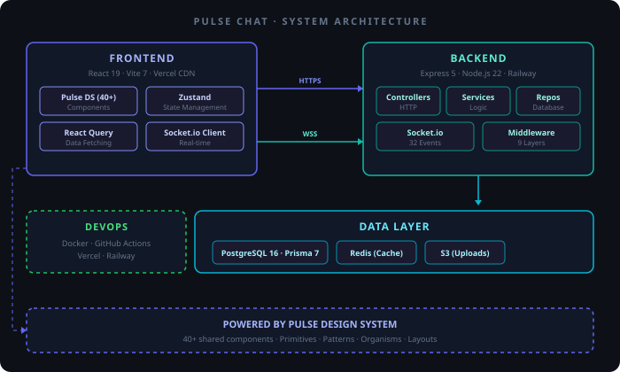
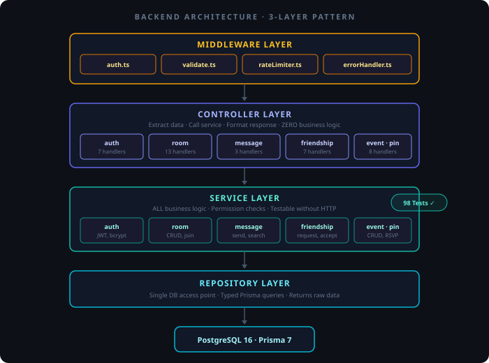
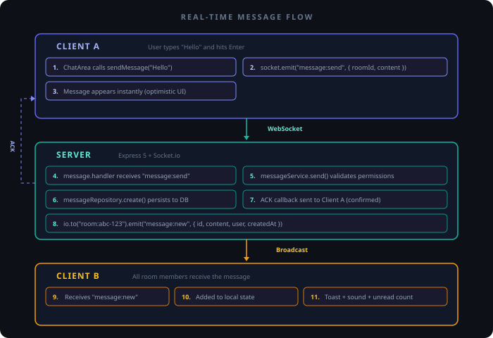
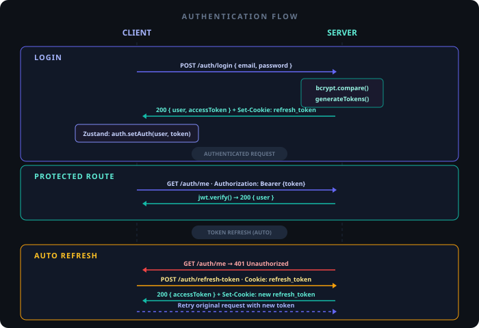
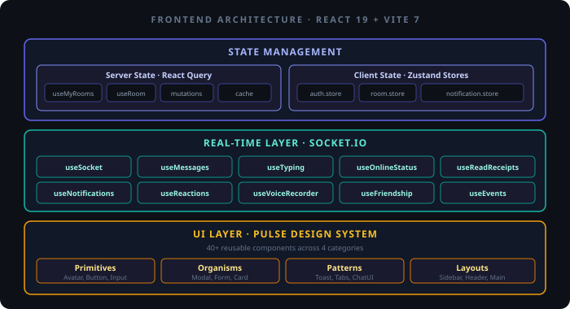

# System Architecture

> Pulse Chat · Real-time messaging platform built with React 19, Express 5, Socket.io, and PostgreSQL.

---

## High-Level Architecture

<div align="center">
  
</div>

---

## Backend Architecture (3-Layer)

The server follows a strict **Controller → Service → Repository** pattern with zero business logic in controllers.

<div align="center">
  
</div>

---

## Real-time Message Flow

How a message travels from sender to receiver in real-time:

<div align="center">
  
</div>

---

## Authentication Flow

<div align="center">
  
</div>

---

## Frontend Architecture

<div align="center">
  
</div>

---

## Database Schema

| Model | Key Fields | Notes |
|-------|-----------|-------|
| **users** | id, email (UQ), password, name, avatar, bio, status | `UserStatus` enum |
| **rooms** | id, name, owner_id (FK), is_private, invite_code (UQ) | Supports public/private |
| **room_members** | user_id + room_id (UQ), role | `Role` enum (ADMIN, MEMBER) |
| **messages** | id, content, type, client_id (UQ), reply_to_id (self-ref) | Soft delete, cursor pagination |
| **message_reactions** | user_id + message_id + emoji (UQ) | Toggle-based |
| **friendships** | sender_id + receiver_id (UQ), status | `FriendStatus` enum |
| **pinned_messages** | message_id + room_id (UQ), pinned_by | Per-room pinning |
| **events** | id, title, room_id, start/end_time, status | `EventStatus` enum |
| **event_invites** | event_id + user_id (UQ), status, responded_at | `InviteStatus` enum |

**10 models · 6 enums · 8+ indexes**

---

## Key Technologies

| Layer | Technology | Purpose |
|-------|-----------|---------|
| Frontend | React 19 + Vite 7 | SPA with HMR |
| UI Components | Pulse Design System | 40+ shared components |
| State (Server) | React Query | Cache, mutations, staleTime |
| State (Client) | Zustand | Auth, room selection, notifications |
| Real-time | Socket.io | 32 bidirectional events |
| Backend | Express 5 + TypeScript | REST API (28 routes) |
| ORM | Prisma 7 | Type-safe queries, migrations |
| Database | PostgreSQL 16 | 10 models, managed on Railway |
| Auth | JWT (access + refresh) | httpOnly cookies for refresh |
| Testing | Vitest | 98 unit tests (service layer) |
| DevOps | Docker + GitHub Actions | CI/CD pipeline |
| Hosting | Cloudflare Workers (client) + Railway (server) | Edge CDN + managed infra |

---

## File Structure

```
realtime-chat/
├── client/                          # Frontend (React 19 + Vite 7)
│   ├── src/
│   │   ├── core/                    # Pulse Design System (40+ components)
│   │   │   ├── primitives/          # Avatar, Button, Input, Badge...
│   │   │   ├── organisms/           # Modal, Form, Card, Drawer...
│   │   │   ├── patterns/            # Toast, Tabs, SearchBar, ChatUI...
│   │   │   └── layouts/             # Sidebar, Header, MainContent
│   │   ├── pages/
│   │   │   ├── auth/                # LoginPage, RegisterPage
│   │   │   └── chat/                # ChatLayout, RoomSidebar, RoomView
│   │   ├── hooks/                   # useSocket, useMessages, useTyping...
│   │   ├── services/                # api.ts, auth.service, room.service...
│   │   ├── store/                   # auth.store, room.store, notification.store
│   │   └── types/                   # room.ts, shared types
│   └── vite.config.ts
│
├── server/                          # Backend (Express 5 + TypeScript)
│   ├── src/
│   │   ├── config/                  # env.ts, database.ts, socket.ts
│   │   ├── controllers/             # 7 controllers (28 routes)
│   │   ├── services/                # 7 services (all business logic)
│   │   │   └── __tests__/           # 98 unit tests (Vitest)
│   │   ├── repositories/            # 7 repositories (Prisma queries)
│   │   ├── routes/                  # Route definitions
│   │   ├── events/                  # Socket.io event handlers
│   │   ├── middleware/              # 9 middleware layers
│   │   ├── errors/                  # AppError, AuthError, NotFoundError
│   │   └── app.ts                   # Server entry point
│   ├── prisma/
│   │   ├── schema.prisma            # 10 models, 6 enums
│   │   └── migrations/              # Versioned migrations
│   └── tsconfig.json
│
├── docs/                            # Architecture documentation
│   ├── architecture.md              # This file
│   ├── decisions.md                 # Architecture Decision Records
│   ├── scaling.md                   # Scaling strategy
│   └── why-i-built-this.md          # Project motivation
│
├── .github/workflows/ci.yml         # CI/CD pipeline
├── docker-compose.yml               # Local dev (5 services)
└── eslint.config.mjs                # Shared ESLint config
```
