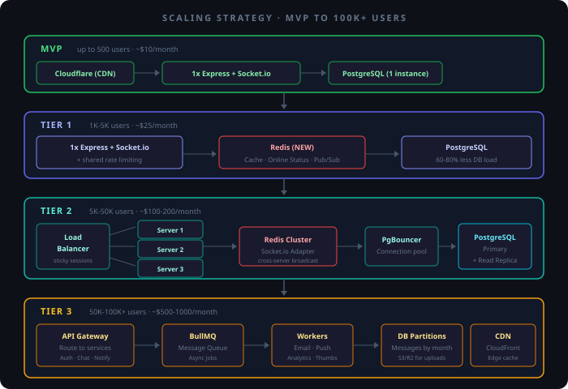
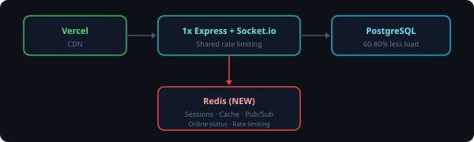
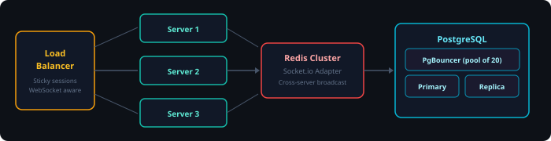
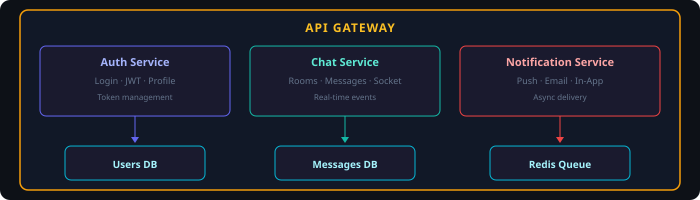

# Scaling Strategy

> How to scale Pulse Chat from hundreds to hundreds of thousands of concurrent users.
> Each tier includes what to change, why, and estimated cost.

---

## Overview

<div align="center">
  
</div>

---

## Current Architecture (MVP · up to 500 concurrent users)

<div align="center">
  
</div>

**Current capacity:**
- 1 Node.js server = ~10K WebSocket connections (limited by RAM)
- PostgreSQL without connection pooling = ~100 concurrent connections
- Uploads on local disk = limited by container storage
- Rate limiting in-memory (HTTP + Socket) = not shared between instances
- Socket registry in-memory (`Map<userId, Set<socketId>>`) = O(1) online check
- Offline message queue (client-side) + idempotency dedup (clientId) for resilience
- Structured logging (Pino) with request ID correlation + JSON in prod
- In-memory metrics (HTTP + socket) + error tracking by fingerprint
- Graceful shutdown with Prisma disconnect + health check 503

**Cost:** ~$10/month (Railway Hobby + Cloudflare Workers Free)

---

## Tier 1: 1K–5K concurrent users

### What to add:

**1. Redis (Session + Cache + Pub/Sub)**
<div align="center">
  
</div>

**Why:**
- Cache frequent queries (room lists, profiles) → reduces DB load by 60-80%
- Online status in Redis (SADD/SREM) instead of memory → ready for multiple servers
- Shared rate limiting (Redis INCR + EXPIRE) → works with horizontal scaling

**Implementation:**
```typescript
// Cache hierarchy
const rooms = await redis.get(`user:${userId}:rooms`)
  ?? await db.room.findMany({ where: { members: { some: { userId } } } })

// Online status
await redis.sadd(`room:${roomId}:online`, userId)
await redis.srem(`room:${roomId}:online`, userId)

// Rate limiting
const count = await redis.incr(`ratelimit:${userId}:messages`)
if (count === 1) await redis.expire(`ratelimit:${userId}:messages`, 5)
if (count > 10) throw new RateLimitError()
```

**Cost:** ~$25/month (+$5 Redis)

---

## Tier 2: 5K–50K concurrent users

### What to add:

**1. Horizontal Scaling (multiple servers)**
<div align="center">
  
</div>

**2. Socket.io with Redis Adapter**

The problem: User A is on Server 1, User B on Server 2. When A sends a message, `io.to(room)` only emits to connections on Server 1.

The solution: `@socket.io/redis-adapter` does pub/sub between servers via Redis.

```typescript
import { createAdapter } from '@socket.io/redis-adapter'
import { createClient } from 'redis'

const pubClient = createClient({ url: REDIS_URL })
const subClient = pubClient.duplicate()

io.adapter(createAdapter(pubClient, subClient))
// Now io.to("room:123").emit() works cross-server
```

**3. Connection Pooling (PgBouncer)**
- App connections → PgBouncer (pool of 20) → PostgreSQL
- Without PgBouncer: 3 servers × 10 connections = 30 DB connections
- With PgBouncer: 3 servers → PgBouncer (20 pooled) → PostgreSQL

**4. Read Replica**
- Read queries (list rooms, history, search) → Read Replica
- Write queries (create message, join room) → Primary
- Prisma natively supports this via `$extends` with read replicas

**5. CDN for Uploads (S3/R2)**
```typescript
// Instead of local disk:
const s3 = new S3Client({ region: 'us-east-1' })
const url = await getSignedUrl(s3, new PutObjectCommand({
  Bucket: 'chat-uploads',
  Key: `avatars/${userId}/${filename}`,
}))
// Client uploads directly to S3 (doesn't go through server)
```

**Cost:** ~$100-200/month

---

## Tier 3: 50K–100K+ concurrent users

### What to add:

**1. Message Queue (BullMQ + Redis)**
<div align="center">
  
</div>

**Why:** Long-running operations should not block the request. Sending notification emails, generating image thumbnails, processing analytics ·all go to a queue.

**2. Database Partitioning**

Messages are append-only and the table grows indefinitely. Partition by date:

```sql
-- Partition by month
CREATE TABLE messages (
  id UUID,
  content TEXT,
  room_id UUID,
  created_at TIMESTAMPTZ
) PARTITION BY RANGE (created_at);

CREATE TABLE messages_2026_01 PARTITION OF messages
  FOR VALUES FROM ('2026-01-01') TO ('2026-02-01');

CREATE TABLE messages_2026_02 PARTITION OF messages
  FOR VALUES FROM ('2026-02-01') TO ('2026-03-01');
```

Recent queries (last 30 days) = fast. Old history = slower, but accessible.

**3. Microservices (if truly necessary)**

<div align="center">
  
</div>

**When to migrate to microservices:**
- When different teams work on different features
- When a part of the system needs to scale independently (chat vs auth)
- NEVER prematurely ·operational complexity is 10x higher

**Cost:** ~$500-1000/month

---

## Scaling Decision Matrix

| Metric | Threshold | Action |
|---|---|---|
| DB connections > 80% pool | 80 connections | Add PgBouncer |
| Response time p95 > 500ms | Consistent | Add Redis cache |
| WebSocket connections > 8K/server | 8,000 | Horizontal scaling + Redis adapter |
| Messages/min > 10K | 10,000 | Message queue (BullMQ) |
| DB size > 50GB | 50 GB | Table partitioning |
| Upload storage > 100GB | 100 GB | Migrate to S3/R2 |
| Read queries > 80% total | 80% | Add read replica |

---

## Current Feature Set (implemented)

| Feature | Stack | Notes |
|---|---|---|
| **Auth** | JWT + refresh token | Cookie-free option (Cloudflare proxy compat) |
| **Rooms** | CRUD + members | Join/leave + admin roles + invite codes |
| **Messages** | Socket.io realtime | TEXT, IMAGE, FILE, VOICE types |
| **Voice messages** | MediaRecorder + Multer | Record, upload, playback with duration |
| **Read receipts** | Socket.io events | Per-room last-read tracking |
| **Typing indicators** | Socket.io events | Debounced, per-room |
| **Search** | Prisma `contains` | In-room full-text search |
| **Edit messages** | Socket.io + soft update | Author-only, TEXT-only, shows "(edited)" |
| **Delete messages** | Socket.io + soft delete | Author or admin, shows placeholder |
| **Replies** | Self-referencing FK | Quote preview above bubble |
| **Reactions** | Toggle pattern + aggregation | Emoji chips with count, unique per user+message+emoji |
| **Friendships** | Request/accept/decline | Socket notifications, auto-accept reverse requests |
| **Pinned messages** | Admin/owner only | Pin/unpin with room-wide list |
| **Events/Calendar** | CRUD + invites + RSVP | Room events with invite system |
| **File uploads** | Multer + static serve | Image preview + file download |
| **Chat wallpapers** | Client-side themes | Customizable chat backgrounds |
| **Offline queue** | Client-side queue + idempotency | Exponential backoff retry, clientId dedup |
| **Reconnection sync** | `message:sync` socket event | Fetches missed messages since last timestamp |
| **Socket rate limiting** | Per-event in-memory counters | 10 msg/5s, 5 edit/5s, 3 typing/2s |
| **Socket registry** | In-memory `Map<userId, Set<socketId>>` | O(1) online check, multi-device support |
| **Structured logging** | Pino + pino-http | JSON in prod, pretty in dev, redact sensitive fields |
| **Request ID** | UUID middleware + X-Request-ID header | Correlation across logs and error responses |
| **Performance metrics** | In-memory collector + `/admin/metrics` | HTTP, socket, memory, uptime stats |
| **Error tracking** | In-memory store + `/admin/errors` | Grouped by fingerprint, max 100 entries |
| **Graceful shutdown** | Ordered task registry | Socket.io → HTTP → Prisma → metrics log |

---

## What We Chose NOT to Do (and Why)

| Feature | Why Not |
|---|---|
| **Microservices** | Operational complexity not justified for 1 developer. Modular monolith (3 layers) is more productive. |
| **Kubernetes** | Over-engineering for < 100K users. Railway auto-scales containers. |
| **GraphQL** | REST is simpler to demonstrate and document (Swagger). Chat doesn't have query flexibility needs. |
| **E2E Encryption** | Focus is backend architecture, not cryptography. Documented in `/docs/decisions.md#adr-008`. |
| **WebRTC** | Would be needed for video/voice calls. For text, Socket.io is sufficient and simpler. |
| **Elasticsearch** | Full-text search with Prisma `contains` is sufficient up to ~1M messages. |
